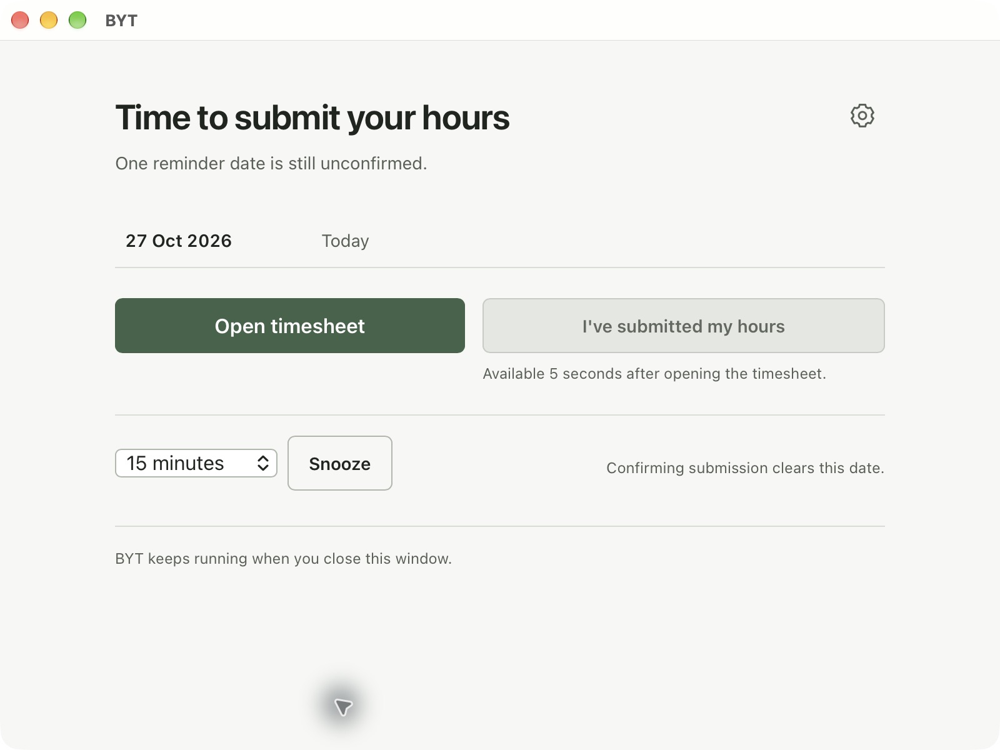
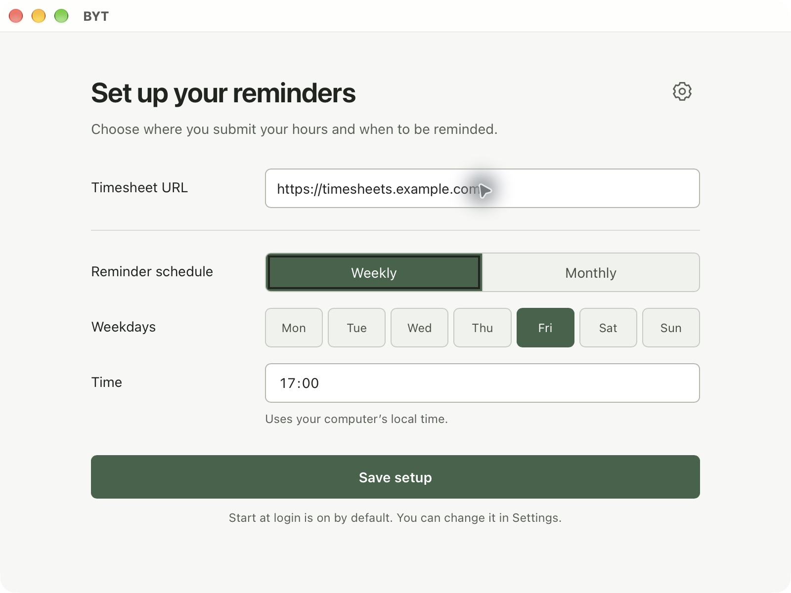
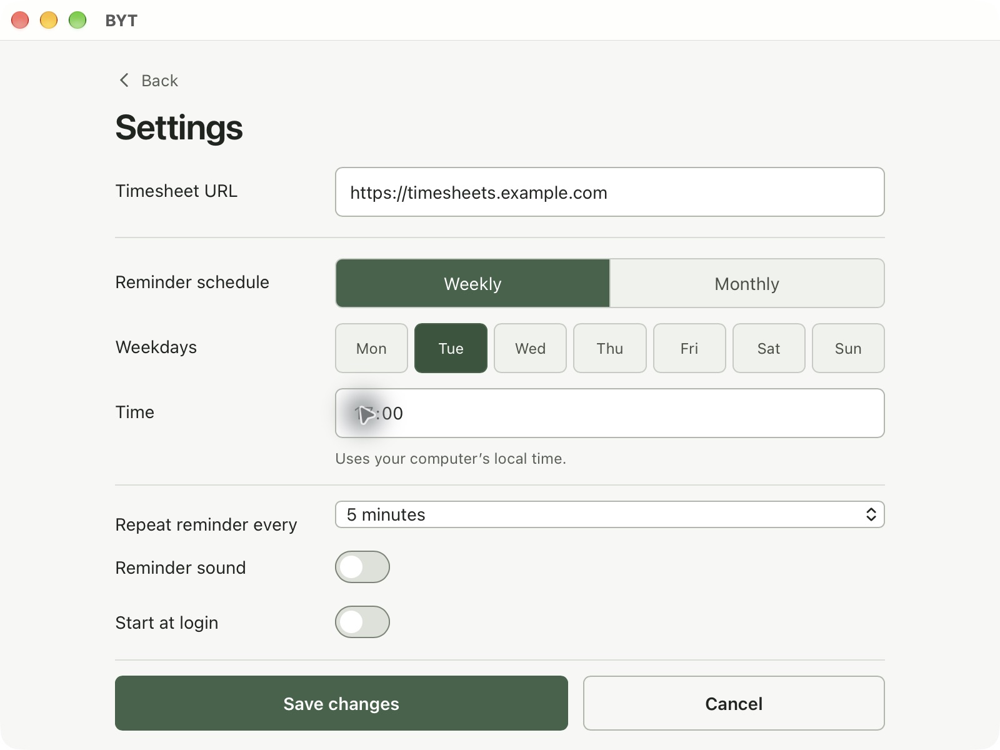

# BYT · Book Your Time

A desktop reminder to submit your working hours in your company's timesheet system.
BYT runs locally on macOS and Windows. No BYT account or backend required.

**[Download the latest release](https://github.com/dimitarradulov/book-your-time/releases/latest)**
· [Report a problem](https://github.com/dimitarradulov/book-your-time/issues)
· [Contribute](CONTRIBUTING.md)

## What BYT does

- Reminds you on selected weekdays or on a separate booking date for each month.
- Repeats reminders until you confirm submission, with snooze for 15 minutes,
  30 minutes, or one hour.
- Carries unconfirmed dates into the next scheduled reminder.
- Opens your timesheet in your default browser.
- Keeps running in the Windows system tray or macOS menu bar when you close its window.
- Offers optional reminder sound and launch at login.
- Stores settings and reminder state on your computer. Scheduling works offline
  and follows your computer's local time.

BYT does not enter or submit hours for you. It does not connect to your company's
account, sync between computers, or provide a completion history.

## Install

Open the [latest release](https://github.com/dimitarradulov/book-your-time/releases/latest)
and choose the installer for your computer:

| Computer | Download |
| --- | --- |
| Mac with Apple silicon, M1 or newer | `BYT_*_aarch64.dmg` |
| Mac with an Intel processor | `BYT_*_x64.dmg` |
| Windows x64 | `BYT_*_x64-setup.exe` |

On macOS, open the DMG and drag BYT into **Applications**. The Mac builds are
signed and notarized.

On Windows, run the setup executable. The current Windows installer is unsigned,
so Windows may display an unknown-publisher or SmartScreen warning.

Download an installer from the release's **Assets** section. The **Source code**
archives are for developers. You do not need Node.js or Rust to use BYT.

## Set up your reminders

1. Open BYT and enter your timesheet URL.
2. Choose a weekly schedule or enter your company's monthly booking dates.
3. Choose the reminder time and select **Save setup**.
4. Adjust **Reminder sound**, **Start at login**, and the repeat interval in **Settings**.

For monthly schedules, enter dates as your company announces them. Each month has
one booking date, and all dates share the same reminder time. BYT prompts you if
the next month's date is missing. It does not invent a date for that month.

When a reminder appears, select **Open timesheet** and submit your hours on the
website. Then select **I've submitted my hours** in BYT to clear the listed dates.
Confirmation becomes available five seconds after BYT successfully opens the link.
Opening the website alone does not complete a reminder.

Use **Snooze** when you need more time. Closing the window keeps BYT running;
select **Quit BYT** from its tray or menu bar menu to stop it.

## Screenshots

<table>
  <tr><th>First-time setup</th><th>Settings</th></tr>
  <tr>
    <td></td>
    <td></td>
  </tr>
</table>

Screenshots show the macOS app with example settings. Windows uses its native
window frame.

## Updates and help

Automatic updates are not included. Download newer versions from
[Releases](https://github.com/dimitarradulov/book-your-time/releases).

For bugs or suggestions, [open an issue](https://github.com/dimitarradulov/book-your-time/issues)
with your operating system, BYT version, and what happened. Remove private URLs
or company information from screenshots.

## Development

BYT uses Tauri 2, Next.js, React, TypeScript, and Rust. See
[CONTRIBUTING.md](CONTRIBUTING.md) for setup, checks, architecture, and releases.
[SPEC.md](SPEC.md) defines the agreed first-version behavior.

### Prerequisites

Developer tools are required only when building from source. See the
[developer prerequisites](CONTRIBUTING.md#prerequisites).

### App icon

The editable icon is [app-icon.svg](app-icon.svg). See the
[icon workflow](CONTRIBUTING.md#app-icon) to regenerate the platform assets.
